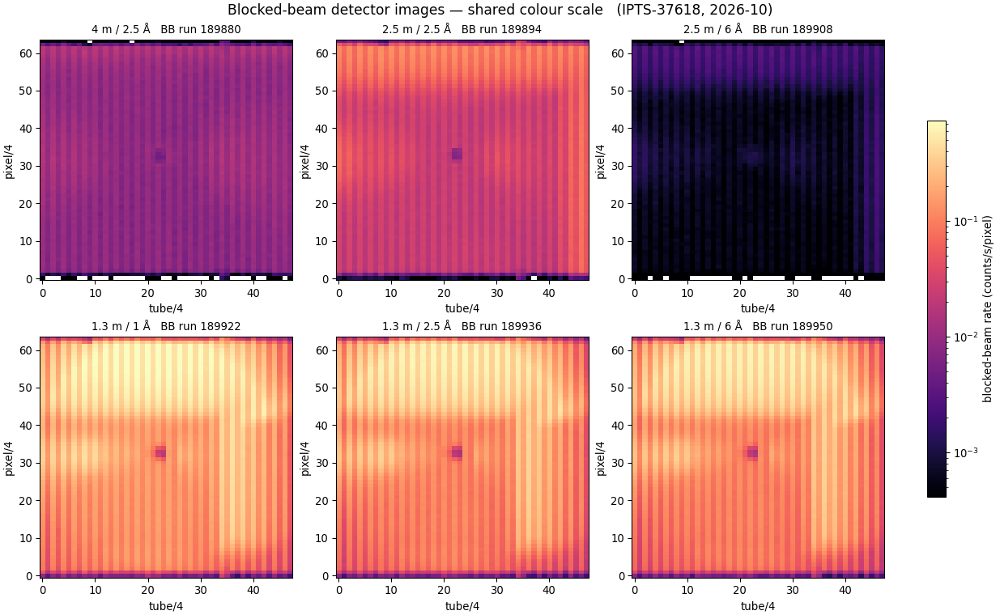
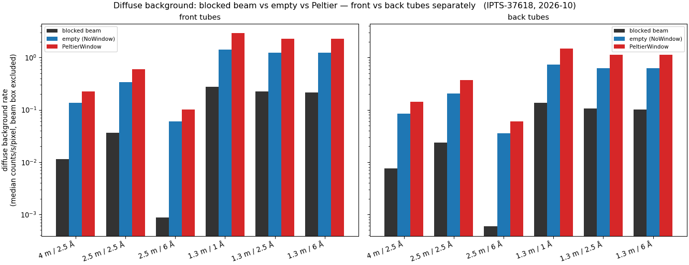
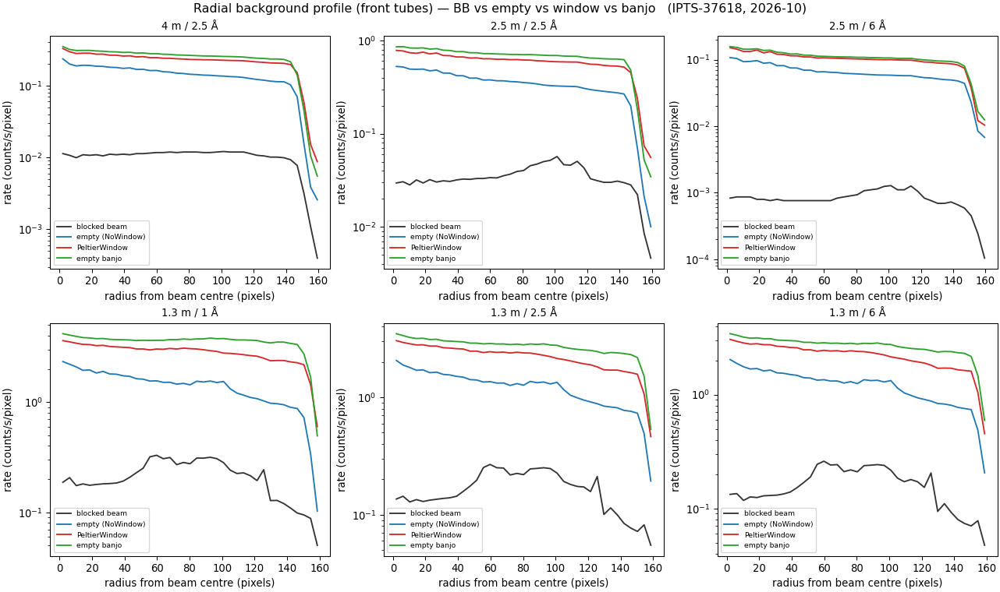
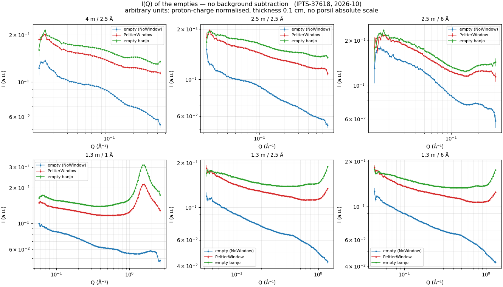

# Backgrounds 2026B — blocked beam, empty beam, window, banjo

**Date:** 2026-10-14 · **drtsans:** stable `1.35.0` · **data:** IPTS-37618, Oct 2026 batch (runs 189867+):
blocked beam, empty-NoWindow, PeltierWindow and empty-banjo S-runs at every distance/band · **scripts:**
`2026B_mp/reduction/floods2026B/bb_compare.py` (2D maps + diffuse-background + radial, raw events, no
reduction), `iq_empty.py` / `iq_plot.py` (I(Q), no background subtraction)

Two questions about the background measurements in the Oct-2026 batch:

1. How strong is the blocked-beam background, and how does it vary with configuration?
2. A colleague's suspicion: **is the blocked-beam background actually stronger than the "empty beam"**
   (empty-NoWindow or PeltierWindow) scattering?

## Blocked-beam images, one colour scale

Raw event rate (counts / s / pixel, no corrections) for each configuration's blocked-beam run, all on the
**same** log colour scale, so absolute strength is directly comparable:

The blocked-beam background is strongest at **1.3 m** and weakest at **4 m** and **2.5 m / 6 Å**. The dark
spot at the centre is the beam block itself (it absorbs the direct beam); the upper half runs a little
hotter than the lower, and there is a faint vertical step near tube ~135 that tracks a detector-panel
boundary.

## Is the blocked beam stronger than the empty beam? No

The metric is the **diffuse background rate**: the median pixel rate (raw events ÷ run duration, so
counts / s / pixel) with the direct-beam box excluded, so it reflects the diffuse scattering only, not
the direct beam. The detector's **front and back tubes sit on very different scales** — front tubes face
the sample and are less shadowed, so they run ~1.6× hotter than the back tubes — so the two are never
mixed: the medians below are taken over front tubes and back tubes **separately** (front/back fixed per
configuration from the strong empty-beam run).

**Front tubes** (median counts / s / pixel, beam box excluded):

| config | blocked beam | empty (NoWindow) | PeltierWindow | empty banjo |
|---|---|---|---|---|
| 4 m / 2.5 Å | 0.012 | 0.136 | 0.227 | 0.257 |
| 2.5 m / 2.5 Å | 0.037 | 0.340 | 0.604 | 0.695 |
| 2.5 m / 6 Å | 0.0009 | 0.060 | 0.101 | 0.107 |
| 1.3 m / 1 Å | 0.277 | 1.406 | 2.909 | 3.659 |
| 1.3 m / 2.5 Å | 0.223 | 1.235 | 2.266 | 2.767 |
| 1.3 m / 6 Å | 0.215 | 1.226 | 2.269 | 2.749 |

**Back tubes** (median counts / s / pixel, beam box excluded):

| config | blocked beam | empty (NoWindow) | PeltierWindow | empty banjo |
|---|---|---|---|---|
| 4 m / 2.5 Å | 0.008 | 0.085 | 0.143 | 0.161 |
| 2.5 m / 2.5 Å | 0.024 | 0.207 | 0.371 | 0.424 |
| 2.5 m / 6 Å | 0.0006 | 0.035 | 0.061 | 0.064 |
| 1.3 m / 1 Å | 0.135 | 0.731 | 1.494 | 1.936 |
| 1.3 m / 2.5 Å | 0.105 | 0.626 | 1.142 | 1.412 |
| 1.3 m / 6 Å | 0.101 | 0.623 | 1.142 | 1.401 |

In both the front and the back tubes, the blocked-beam background is **5–60× weaker** than the empty-beam
scattering — not stronger. The ordering is always empty banjo ≥ PeltierWindow > empty (NoWindow) ≫ blocked
beam: the sample-environment scattering (cell windows, air, the Peltier window) dominates, and the
blocked-beam leakage is small. (Front tubes run ~1.6× hotter than back tubes for every one of them, which
is exactly why the two are reported apart rather than as one all-pixel median.)

### Does it hold at high angle too?

The median above is dominated by the mid-detector. Since blocked-beam leakage is flatter than the
beam-driven scattering, the fairest test of the colleague's idea is at the **detector edge**, where the
empty-beam scattering falls off. The radial profiles (rate vs distance from the beam centre, **front tubes
only** so the front/back alternation does not add a zig-zag) show it does not change the answer:

At every radius out to the detector corner, the blocked beam stays well below the empty beam, the window
and the banjo. It never overtakes them — even where all the curves roll off at the very edge, the blocked
beam is the lowest of the four. So the blocked-beam background is genuinely the weakest of these
backgrounds everywhere on the detector. (This is also why subtracting it changes a flood by only a
fraction of a percent — see **Water (blocked beam)**.)

## I(Q) of the empties — no background subtraction

Finally, the scattering contribution of each "empty" as I(Q), reduced normally (new H2O flood **of the
same configuration** for sensitivity — e.g. `Sensitivity_patched_H2O_1o3m2o5a_189933.nxs` at 1.3 m/2.5 Å —
solid angle, θ-dependent transmission) but with **no background subtraction**, so each curve is that
measurement's own scattering:

> **Units are arbitrary (a.u.), not cm⁻¹.** These were not put on absolute scale (no porsil calibration):
> each is only proton-charge normalised, with a constant assumed thickness of 0.1 cm and
> `standardAbsoluteScale = 1`. The I(Q) `.dat` headers say "1/cm", but read the values as relative — only
> comparisons between curves (which scatters more, where the peaks sit) are meaningful.

The empty banjo and the PeltierWindow scatter more than the empty (NoWindow) beam across the whole Q
range — the cell windows and the Peltier window are real scatterers, which is why a flood or a sample run
in them needs its matching empty subtracted. The empty-NoWindow curve is the floor: beam and air only.

At **1.3 m / 1 Å** — the only configuration that reaches Q ≈ 2.5 Å⁻¹ — the empty banjo shows its quartz
**first sharp diffraction peak at Q ≈ 1.54 Å⁻¹** (the Peltier window, also silica, shows a weaker one at
the same Q). This is the same fused-silica peak identified in **Water 8**, and it is exactly why the
recommended flood is water *with the banjo subtracted*: the banjo cell carries this coherent peak, so a
raw water-in-banjo flood would print it into every reduction if the empty banjo were not removed.
