# Direct beam over the years — 4 m flux runs at 2.5 Å and 10 Å

**Date:** 2026-10-20 · **data:** raw event files from 25 calibration proposals, 2014-08-16 → 2026-08-04 ·
**scripts:** `2026B_mp/reduction/directbeam_years/` — `collect_directbeam.py` (run selection + raw
detector image per run), `make_images.py` (figures), `tube_efficiency_test.py` (detector tests),
`shortest_slice_overlay.py` (shortest-λ overlay),
`make_page.py` (this page) · no Mantid, no drtsans, no
corrections: just the detector events of each run, counted per pixel.

The empty-beam "flux" run is measured in every calibration experiment, usually at **4 m with the 25 mm Cd
slit 1** (`d25_Cd`). Recent images of the 2.5 Å one have looked like a **split beam spot**. This page collects
every such run — **48 at 2.5 Å and 45 at 10 Å**, 8 of which turned out to have no beam (the 10 Å
set is the comparison: it was not seen to split)
— and shows the same detector window for each, so they can be compared directly across the years.

## How the images are made

- **Run selection.** From ONCat (and, for the four oldest proposals that ONCat does not index — 12266,
  13554, 16594, 17292 — from the titles stored in the files): title contains **"flux"** and a **2.5a** or
  **10a / 10.0a** wavelength. Alignment scans (`Align:…`) and monochromatic spread runs (`sp5/10/15`) are
  excluded (table at the bottom). Three proposals with no flux-titled run (16594, 24648, 26015) have
  **"T-empty beam 4m 2.5A / 10A"** runs instead — the same direct-beam measurement under another title — and
  those are included and marked *T-empty*.
- **Image.** Every detector event is counted in its pixel (raw counts, no normalisation). The tubes are put
  in **physical left-to-right order**: inside each 8-tube bank the detector IDs run 4 front tubes then 4 back
  tubes, while physically they alternate front/back (ID tubes 0,4,1,5,2,6,3,7 — checked against the Mantid
  EQSANS instrument definition). **x = tube 0–191 in that physical order** (tube 0 at x = +524 mm), **y =
  pixel 0–255 along the tube** (0 = bottom). Even tubes are the front layer, odd tubes the back layer.
- **Window.** The direct beam sits at **tube ≈ 90, pixel ≈ 131** in every year, so one fixed window is used
  for all runs: **tubes 60–123 × pixels 100–163 (64 × 64)**. The galleries also show a zoom on the core
  (tubes 82–99 × pixels 120–143). The aspect is physical (a tube is 5.49 mm wide, a pixel 4.09 mm tall), so a
  round spot looks round.
- Each image is scaled to its **own** maximum (counting times and slits differ). Log images span 4 decades
  below the peak.

## Gallery — 2.5 Å, beam core (linear)

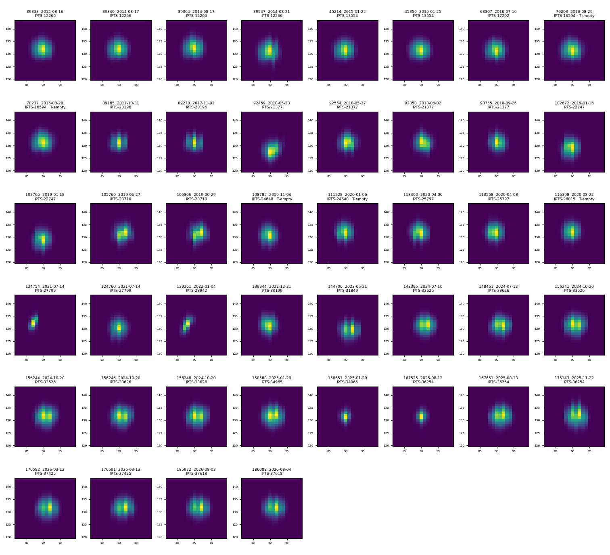

## Gallery — 10 Å, beam core (linear)

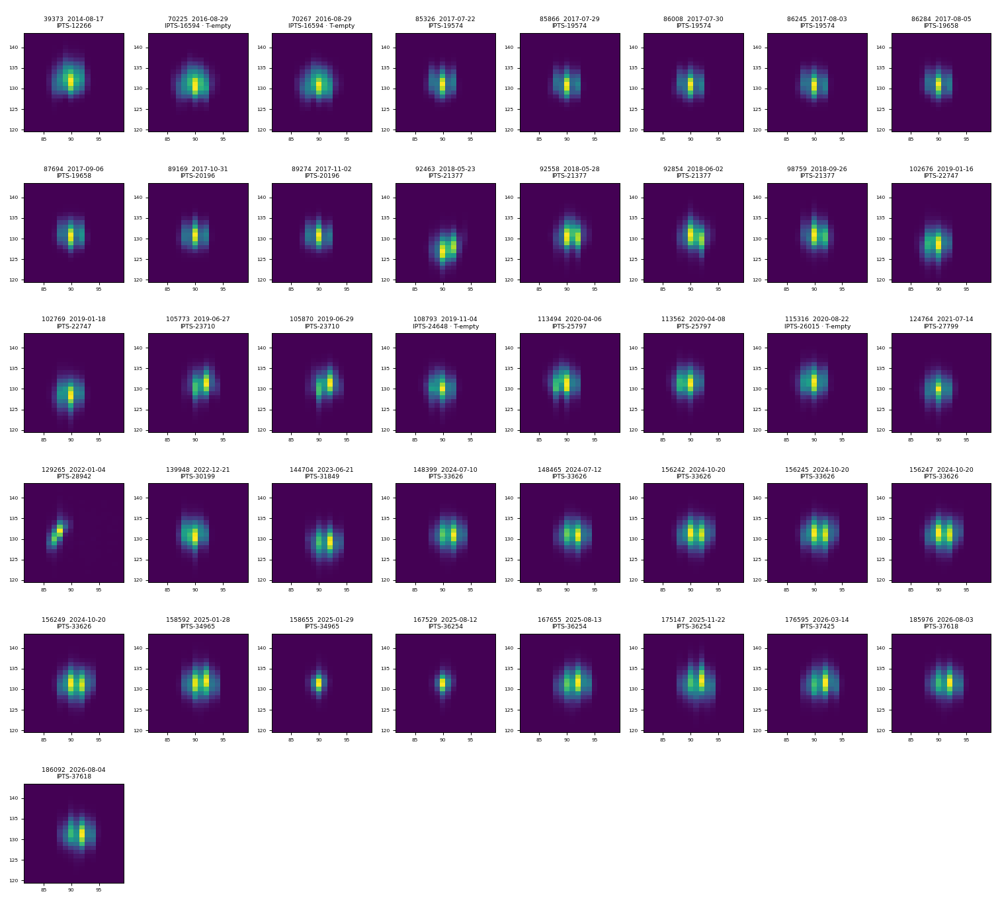

## Gallery — 2.5 Å, full 64 × 64 window (log)

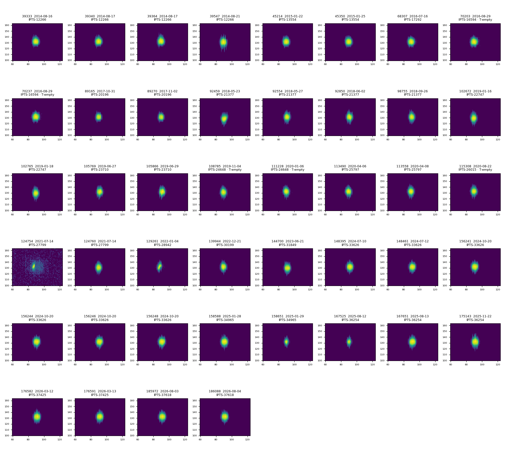

## Gallery — 10 Å, full 64 × 64 window (log)

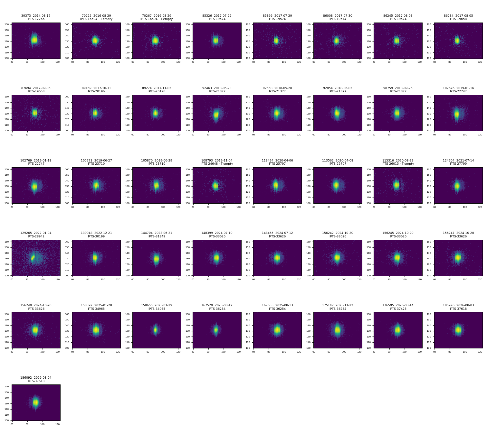

## What the images show (first look)

**Beam position.** The centroid has stayed within ~2 tubes and ~4 pixels for twelve years, and the 2.5 Å and
10 Å beams always sit at the same place (same-day pairs agree to 0.1 tube). At 4 m: 2014 → 2022 mostly at
**tube ≈ 89.5–90.0** (centred on a front-layer tube; 2018-05 and 2019-06 briefly at 90.6–91.1), and **from
2023-06 on at tube ≈ 90.8–91.3** — centred on *back-layer* tube 91. The slit-1 motor setpoint (`beamslit1`)
changed from **269.88 to 266.321** somewhere between 2023-06 and 2024-07 (grey band), but the 2023-06 run
was already at 91.2 with the old setpoint, so the slit change did not cause the shift. The slit-1 index
`vBeamSlit` is 7 throughout. (The two 1.3 m pairs sit at tube ≈ 90 — a different geometry.)

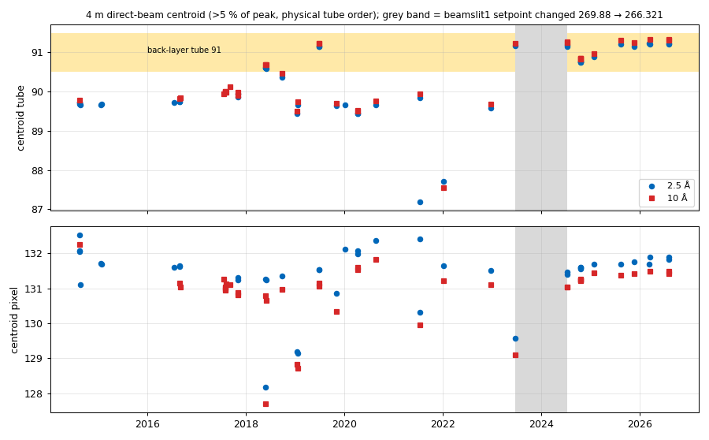

**Two bright columns.** From 2023-06 on the core shows **two bright columns (tubes 90 and 92) with a dimmer one
(91) between**. Per tube, the front-layer tubes (even) always read higher than the back-layer tubes (odd) in a
direct beam — the back tube sits behind its neighbours. With the beam centred on a front tube (2014–2023) that
gives one bright column; centred on back tube 91 (2023-06 →) it gives two. The front-only and back-only profiles
are each single-peaked, and the vertical profile is single-peaked in every year.

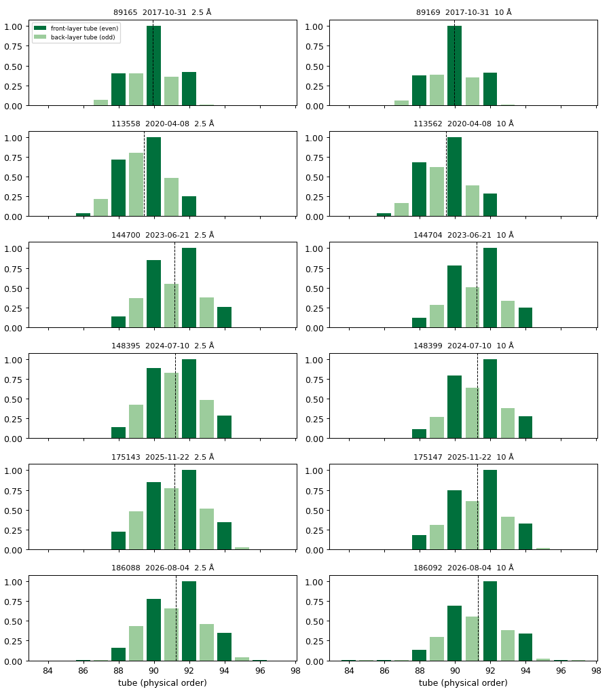

**2.5 Å vs 10 Å.** In these raw images the 10 Å beam has the **same** two-column pattern as 2.5 Å from
2023-06 on — in fact a slightly deeper middle dip (tube 91 / tube 92: 0.55–0.64 at 10 Å vs 0.66–0.83 at 2.5 Å, since
the front layer absorbs more at 10 Å). So the raw counts alone do **not** show a split unique to 2.5 Å.

**Display order matters.** A viewer that draws the tubes in raw detector-ID order puts each bank's 4 front
tubes and 4 back tubes side by side, so every direct beam appears as **two separated blobs** — in every year
and at both wavelengths:

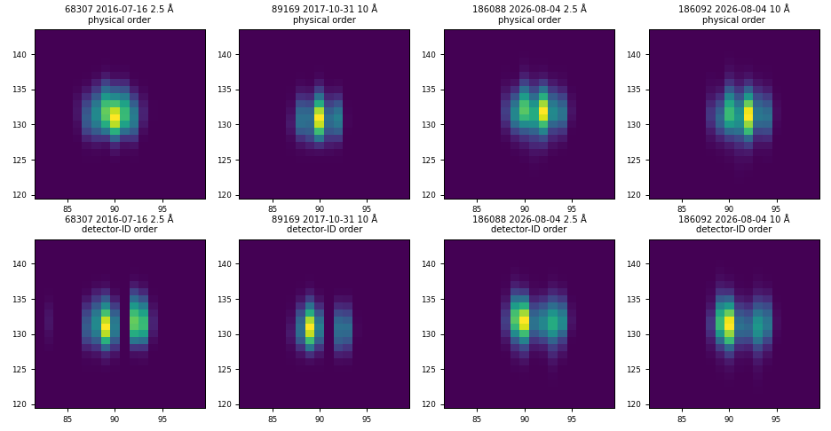

## Is it the detector? Two tests

The two-column look could be the beam or the detector tubes. Two independent tests separate them (script
`tube_efficiency_test.py`, numbers in `tube_efficiency_test.json`).

**Test A — divide by the flood of the same cycle.** The flood records each tube's efficiency. For six
epochs with a 4 m flood measured the same week, the direct beam is divided by that cycle's deployed
sensitivity file. (Its beam-stop area is patched by interpolating *along* each tube, so each tube's level at
the beam centre is still its own measured value.) Green = raw front / back tube, blue = after dividing:

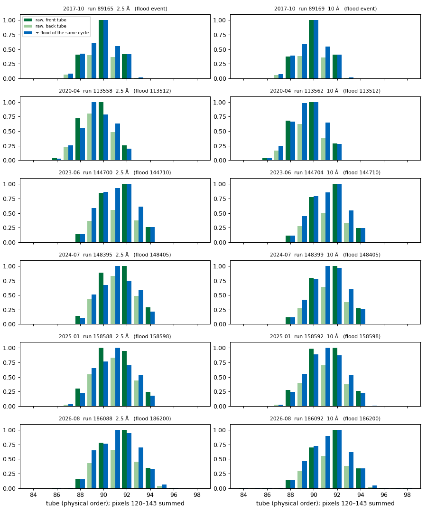

Every epoch, both wavelengths, becomes **one peak** once the tube efficiency is divided out — at tube 90
(2017, 2020) or tube 91–92 (2023 →). The dimmer middle column is the back-layer tube's lower efficiency
(≈ 0.6 of its front neighbours in a diffuse flood: the front tubes' ³He absorbs part of what reaches the back
tubes), not a gap in the beam.

**Test B — wavelength inside one run.** Shadowing by the front layer depends on wavelength (³He absorbs
more at longer λ), so a detector effect must follow the flood's wavelength dependence, while a split in the
beam optics has no reason to. Using raw events (frame-unwrapped TOF → λ) from the Aug-2026 direct beams
186088 (2.5 Å band) and 186092 (10 Å band) and the PMMA flood 186200 measured the same week:

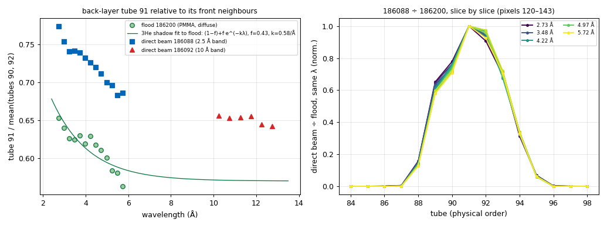

- *Left:* tube 91 relative to tubes 90/92. In the direct beam it falls from 0.77 to 0.69 across the 2.5 Å
  band, **in step with the flood** (0.65 → 0.56): the direct-beam / flood ratio stays at 1.15–1.22 at every λ.
  That constant factor is the beam's own shape (a beam centred near tube 91 is brighter on 91 than on 90/92);
  the λ-dependence is entirely the detector's. The 10 Å direct beam (0.64–0.66) continues the fall; a ³He
  shadow curve fitted to the flood at 2.7–5.7 Å and carried out to 10–13 Å, times the same 1.18, predicts
  ≈ 0.67 — close, given the 2× extrapolation in λ.
- *Right:* each 2.5 Å-band slice of the direct beam divided by the flood slice at the same λ: **the same
  single peak at tube 91 in all 13 slices** (2.7 → 5.7 Å), tube 91 / mean(90, 92) = 1.16–1.22, flat in λ.

**Conclusion.** At the resolution of the detector (one tube = 5.5 mm, one pixel = 4.1 mm) there is **no split
in the direct beam**: the two bright columns are the front/back tube-layer efficiency pattern, which shows
up as two columns once the beam centre moved onto back-layer tube 91 (from 2023-06). It looks the same at
2.5 Å and 10 Å in the raw counts. Not excluded: structure finer than one tube, or a split seen in another
display (e.g. a reduced 2D I(Qx,Qy) or a particular TOF range) — if that is where it was noticed, that is
the next thing to check.

## Shortest-wavelength slice, every cycle — direct beam ÷ flood

The same division as Test B, but for **every visit from 2014 to 2026**, using only the **shortest
wavelength slice** of each band, and overlaid (script `shortest_slice_overlay.py`, numbers in
`shortest_slice_overlay.json`). Each direct beam is paired with the nearest 4 m flood run (thin PMMA, 2.5 Å
band; same week except where noted in the legend). The slice is found from each run's own time of flight:
the first 0.3 Å (2.5 Å band) or 0.5 Å (10 Å band) above the band's rising edge — the band edge itself drifts
from 2.43 Å (2014) to 2.57 Å (2026). Dashed = *T-empty beam* runs. Grey bands mark the back-layer tubes.

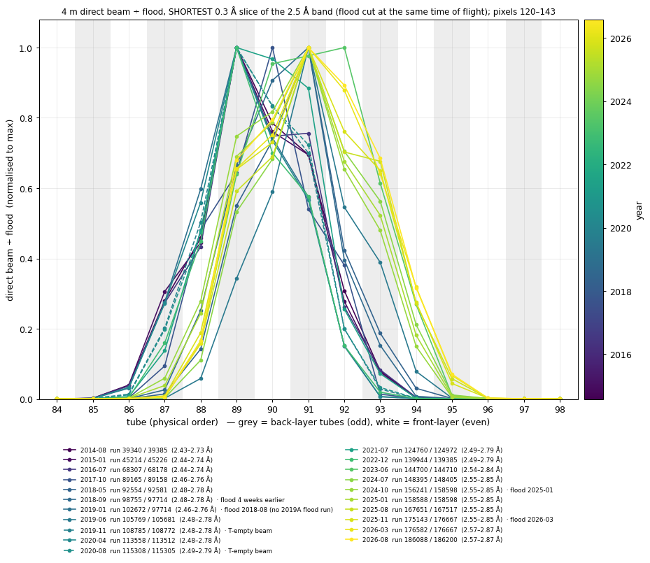

For the 2.5 Å plot the flood is cut at the **same time of flight** (same λ). **No 10 Å flood exists**, so for
the 10 Å plot each flood's **longest** 0.3 Å slice (≈ 5.4–5.8 Å) is used instead — the back/front tube
correction is slightly smaller there than it would be at 10 Å.

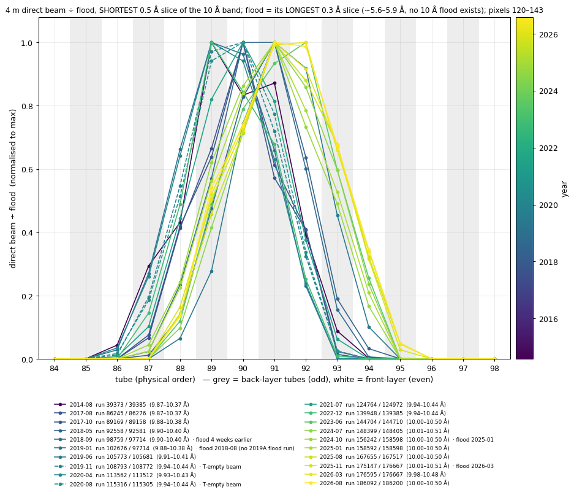

What the overlay shows:

- **Every cycle is one peak**, at both wavelengths — no split, no dip at the beam centre, once the tube
  efficiency is divided out at the shortest wavelength too.
- **Position:** peak on tube 89–90 from 2014 to 2022 (centroid 89.3–89.8; 2018-05/09 and 2019-06 briefly at
  90.3–91.0), on tube 91 from 2023-06 (centroid 90.7–91.3).
- **Width:** the horizontal FWHM (linear interpolation, in tubes of 5.49 mm) was **2.7–3.6 tubes** up to
  2022-12 at 2.5 Å, and **4.2–4.9 tubes from 2023-06**, still growing slowly (4.3 in 2024-07 → 4.9 in
  2026-08). The 10 Å beam follows the same history (3.1–3.8 → 4.0–4.6). So the beam got ~1.3 tubes (~7 mm)
  wider and moved ~1.5 tubes right between 2022-12 and 2023-06 — a change in the beam, but a broadening, not a
  split, and the same in both bands.
- Before ~2023 the inter-pulse minimum holds ~20 % of the band peak (slow neutrons of the previous pulse), so
  the shortest 2.5 Å slice of those years carries some ~6 Å neutrons; the direct beam and the flood are cut
  with the same window, which keeps the ratio consistent, but the older curves are a little less clean (the
  shoulder next to the peak).

**Runs with no direct beam** (8): 108729, 108735, 120664, 120668, 120756, 120760, 135061, 135065. Their peak is ≤ 27 counts/pixel, spread over the whole window
(beam off or shutter closed); they are listed in the tables but left out of the galleries. Runs 124754
(2021-07) and 129261 (2022-01) have far fewer counts than usual and a small, displaced spot — probably a
partially blocked beam.

## Proposals searched

| IPTS | runs dated | 2.5 Å runs | 10 Å runs | note |
|---|---|---|---|---|
| 12266 | 1989-12-31 → 2015-01-20 | 4 | 1 | titles "Flux-empty Al holder, 4m …" (read from the files — not in ONCat) |
| 13554 | 2015-01-20 → 2015-08-20 | 2 | 0 | same title style; no 10 Å run (9.5 / 11 Å measured instead) |
| 17292 | 2016-07-09 → 2017-02-21 | 1 | 0 | no 10 Å run (9.5 / 11 Å measured instead) |
| 16594 | 2016-08-29 → 2016-08-31 | 2 | 2 | no flux-titled runs; 4 m "T-empty beam" runs used instead |
| 18418 | 2017-06-30 → 2017-07-12 | 0 | 0 | no flux or empty-beam runs |
| 19574 | 2017-07-15 → 2017-08-04 | 0 | 4 | "Flux 10a" only; 2.5 Å not measured ("Flux 2a" instead) |
| 19658 | 2017-08-04 → 2017-09-08 | 0 | 2 | "Flux 10a" only; 2.5 Å not measured ("Flux 2a" instead) |
| 20196 | 2017-10-27 → 2017-12-18 | 2 | 2 |  |
| 21377 | 2018-05-22 → 2018-11-13 | 4 | 4 |  |
| 22747 | 2019-01-11 → 2019-06-10 | 2 | 2 |  |
| 23710 | 2019-06-21 → 2019-12-18 | 2 | 2 | 11 "Align:T-flux 4m 10a" alignment runs excluded |
| 24648 | 2019-11-01 → 2021-08-24 | 3 | 2 | no flux-titled runs; 4 m "T-empty beam" runs used instead |
| 25797 | 2020-04-04 → 2020-04-12 | 2 | 2 |  |
| 26015 | 2020-08-20 → 2021-02-12 | 1 | 1 | no flux-titled runs; 4 m "T-empty beam" runs used instead |
| 26825 | 2021-02-12 → 2021-05-17 | 2 | 2 | all four runs have no direct beam (beam off / shutter closed) |
| 27799 | 2021-07-13 → 2021-09-15 | 2 | 1 |  |
| 28942 | 2022-01-03 → 2022-07-28 | 2 | 2 | the May-2022 pair has no direct beam |
| 30047 | 2022-11-23 → 2022-11-26 | 0 | 0 | 13 runs, no flux or empty-beam runs |
| 30199 | 2022-11-28 → 2025-07-14 | 1 | 1 |  |
| 31849 | 2023-06-16 → 2024-06-11 | 1 | 1 |  |
| 33626 | 2024-07-08 → 2026-02-06 | 6 | 6 |  |
| 34965 | 2025-01-27 → 2026-03-05 | 2 | 2 | includes a 1.3 m pair |
| 36254 | 2025-08-08 → 2026-03-11 | 3 | 3 | includes a 1.3 m pair |
| 37425 | 2026-03-11 → 2026-07-30 | 2 | 1 |  |
| 37618 | 2026-08-02 → 2026-10-12 | 2 | 2 | 5 monochromatic "sp" runs excluded |

## Run table — 2.5 Å

`beamslit1` is the slit-1 wheel motor position and `vBeamSlit` the slit-1 index, both from the run's DAS logs (`vBeamSlit` was logged as 0 from 2024-07 to 2025-01). Centroid = intensity-weighted centre of pixels above 5 % of the peak, in the physical tube order.

| IPTS | run | date | run title | total counts | det. distance (m) | duration (s) | beamslit1 motor | vBeamSlit | centroid tube, pixel | note |
|---|---|---|---|---|---|---|---|---|---|---|
| 12266 | 39333 | 2014-08-16 | Flux-empty Al holder, 4m 2.5A | 5,836,344 | 4.00 | 906 | 269.880 | 7 | 89.7, 132.1 |  |
| 12266 | 39340 | 2014-08-17 | Flux-empty Al holder, 4m 2.5A | 5,859,264 | 4.00 | 887 | 269.880 | 7 | 89.7, 132.1 |  |
| 12266 | 39364 | 2014-08-17 | Flux-empty Al holder, 4m 2.5A | 5,424,651 | 4.00 | 890 | 269.880 | 7 | 89.7, 132.5 |  |
| 12266 | 39547 | 2014-08-21 | Flux-empty Al holder, 4m 2.5A | 5,802,258 | 4.00 | 902 | 269.880 | 7 | 89.7, 131.1 |  |
| 13554 | 45214 | 2015-01-22 | Flux-empty Al holder, 4m 2.5A | 6,207,939 | 4.00 | 1098 | 269.880 | 7 | 89.7, 131.7 |  |
| 13554 | 45350 | 2015-01-25 | Flux-empty Al holder, 4m 2.5A | 6,261,201 | 4.00 | 1116 | 269.880 | 7 | 89.7, 131.7 |  |
| 17292 | 68307 | 2016-07-16 | Flux-empty Al holder, 4m 2.5A | 6,558,687 | 4.00 | 959 | 269.880 | 7 | 89.7, 131.6 |  |
| 16594 | 70203 | 2016-08-29 | T-empty beam 4m 2.5A | 1,310,247 | 4.00 | 195 | 269.880 | 7 | 89.7, 131.6 | T-empty beam |
| 16594 | 70237 | 2016-08-29 | T-empty beam 4m 2.5A | 1,320,726 | 4.00 | 194 | 269.880 | 7 | 89.7, 131.6 | T-empty beam |
| 20196 | 89165 | 2017-10-31 | T-flux 4m 2.5a | 9,523,470 | 4.00 | 2342 | 269.880 | 7 | 89.9, 131.3 |  |
| 20196 | 89270 | 2017-11-02 | T-flux 4m 2.5a | 9,860,315 | 4.00 | 2332 | 269.880 | 7 | 89.9, 131.2 |  |
| 21377 | 92459 | 2018-05-23 | T-flux 4m 2.5a | 11,758,561 | 4.00 | 1584 | 269.880 | 7 | 90.6, 128.2 |  |
| 21377 | 92554 | 2018-05-27 | T-flux 4m 2.5a | 21,739,042 | 4.00 | 3121 | 269.880 | 7 | 90.6, 131.3 |  |
| 21377 | 92850 | 2018-06-02 | T-flux 4m 2.5a | 23,058,016 | 4.00 | 3105 | 269.880 | 7 | 90.6, 131.2 |  |
| 21377 | 98755 | 2018-09-26 | T-flux 4m 2.5a | 12,162,659 | 4.00 | 1444 | 269.880 | 7 | 90.4, 131.4 |  |
| 22747 | 102672 | 2019-01-16 | T-flux 4m 2.5a | 12,436,387 | 4.00 | 1443 | 269.880 | 7 | 89.4, 129.2 |  |
| 22747 | 102765 | 2019-01-18 | T-flux 4m 2.5a | 12,399,137 | 4.00 | 1446 | 269.880 | 7 | 89.7, 129.2 |  |
| 23710 | 105769 | 2019-06-27 | T-flux 4m 2.5a | 11,455,716 | 4.00 | 1446 | 269.880 | 7 | 91.1, 131.5 |  |
| 23710 | 105866 | 2019-06-29 | T-flux 4m 2.5a | 11,538,264 | 4.00 | 2996 | 269.880 | 7 | 91.1, 131.5 |  |
| 24648 | 108729 | 2019-11-02 | T-empty beam 4m 2.5A | 1,155 | 4.00 | 175 | 269.880 | 7 | — | **no direct beam**, T-empty beam |
| 24648 | 108785 | 2019-11-04 | T-empty beam 4m 2.5A | 1,228,350 | 4.00 | 144 | 269.880 | 7 | 89.6, 130.9 | T-empty beam |
| 24648 | 111228 | 2020-01-06 | T-empty beam 4m 2.5A | 966,251 | 4.00 | 109 | 269.880 | 7 | 89.7, 132.1 | T-empty beam |
| 25797 | 113490 | 2020-04-06 | T-flux 4m 2.5a | 13,764,113 | 4.00 | 5160 | 269.880 | 7 | 89.4, 132.0 |  |
| 25797 | 113558 | 2020-04-08 | T-flux 4m 2.5a | 13,574,063 | 4.00 | 1538 | 269.880 | 7 | 89.4, 132.1 |  |
| 26015 | 115308 | 2020-08-22 | T-empty beam 4m 2.5A | 1,317,568 | 4.00 | 144 | 269.880 | 7 | 89.7, 132.4 | T-empty beam |
| 26825 | 120664 | 2021-02-13 | T-flux 4m 2.5a | 8,916 | 4.00 | 1368 | 269.880 | 7 | — | **no direct beam** |
| 26825 | 120756 | 2021-02-16 | T-flux 4m 2.5a | 11,636 | 4.00 | 2549 | 269.880 | 7 | — | **no direct beam** |
| 27799 | 124754 | 2021-07-14 | T-flux 4m 2.5a | 47,835 | 4.00 | 1427 | 269.880 | 7 | 87.2, 132.4 |  |
| 27799 | 124760 | 2021-07-14 | T-flux 4m 2.5a | 11,591,281 | 4.00 | 1430 | 269.880 | 7 | 89.8, 130.3 |  |
| 28942 | 129261 | 2022-01-04 | T-flux 4m 2.5a | 1,186,266 | 4.00 | 1422 | 269.880 | 7 | 87.7, 131.6 |  |
| 28942 | 135061 | 2022-05-23 | T-flux 4m 2.5a | 6,893 | 4.00 | 714 | 269.880 | 7 | — | **no direct beam** |
| 30199 | 139944 | 2022-12-21 | T-flux 4m 2.5a | 6,044,201 | 4.00 | 724 | 269.880 | 7 | 89.6, 131.5 |  |
| 31849 | 144700 | 2023-06-21 | T-flux 4m 2.5a d25_Cd | 7,643,246 | 4.00 | 693 | 269.880 | 7 | 91.2, 129.6 |  |
| 33626 | 148395 | 2024-07-10 | T-flux 4m 2.5a d25_Cd | 9,770,686 | 4.00 | 765 | 266.321 | 0 | 91.2, 131.5 |  |
| 33626 | 148461 | 2024-07-12 | T-flux 4m 2.5a d25_Cd | 9,760,592 | 4.00 | 789 | 266.321 | 0 | 91.2, 131.4 |  |
| 33626 | 156241 | 2024-10-20 | T-flux 4m 2.5a d25_Cd | 4,326,587 | 4.00 | 437 | 266.321 | 0 | 90.8, 131.6 |  |
| 33626 | 156244 | 2024-10-20 | T-flux 4m 2.5a d25_Cd | 4,313,216 | 4.00 | 375 | 266.321 | 0 | 90.8, 131.6 |  |
| 33626 | 156246 | 2024-10-20 | T-flux 4m 2.5a d25_Cd | 4,326,302 | 4.00 | 827 | 266.321 | 0 | 90.8, 131.6 |  |
| 33626 | 156248 | 2024-10-20 | T-flux 4m 2.5a d25_Cd | 4,307,811 | 4.00 | 375 | 266.321 | 0 | 90.8, 131.6 |  |
| 34965 | 158588 | 2025-01-28 | T-flux 4m 2.5a d25_Cd | 10,156,593 | 4.00 | 1260 | 266.321 | 0 | 90.9, 131.7 |  |
| 34965 | 158651 | 2025-01-29 | T-flux 1.3m 2.5a d25_Cd | 10,144,049 | 1.30 | 765 | 266.321 | 0 | 89.9, 131.5 | 1.3 m |
| 36254 | 167525 | 2025-08-12 | T-flux 1.3m 2.5a d25_Cd | 10,159,610 | 1.30 | 723 | 266.321 | 7 | 90.1, 131.6 | 1.3 m |
| 36254 | 167651 | 2025-08-13 | T-flux 4m 2.5a d25_Cd no window | 10,296,399 | 4.00 | 719 | 266.321 | 7 | 91.2, 131.7 |  |
| 36254 | 175143 | 2025-11-22 | T-flux 4m 2.5a d25_Cd no window | 9,882,906 | 4.00 | 684 | 266.321 | 7 | 91.2, 131.8 |  |
| 37425 | 176582 | 2026-03-12 | T-flux 4m 2.5a d25_Cd no window | 10,658,416 | 4.00 | 686 | 266.321 | 7 | 91.2, 131.7 |  |
| 37425 | 176591 | 2026-03-13 | T-flux 4m 2.5a d25_Cd no window | 10,621,717 | 4.00 | 679 | 266.321 | 7 | 91.2, 131.9 |  |
| 37618 | 185972 | 2026-08-03 | T-flux 4m 2.5a d25_Cd no window | 10,859,186 | 4.00 | 866 | 266.321 | 7 | 91.2, 131.9 |  |
| 37618 | 186088 | 2026-08-04 | T-flux 4m 2.5a d25_Cd no window | 10,887,997 | 4.00 | 810 | 266.321 | 7 | 91.2, 131.8 |  |

## Run table — 10 Å

| IPTS | run | date | run title | total counts | det. distance (m) | duration (s) | beamslit1 motor | vBeamSlit | centroid tube, pixel | note |
|---|---|---|---|---|---|---|---|---|---|---|
| 12266 | 39373 | 2014-08-17 | Flux-empty Al holder, 4m 10A | 374,023 | 4.00 | 3600 | 269.880 | 7 | 89.8, 132.3 |  |
| 16594 | 70225 | 2016-08-29 | T-empty beam 4m 10A | 47,620 | 4.00 | 387 | 269.880 | 7 | 89.8, 131.1 | T-empty beam |
| 16594 | 70267 | 2016-08-29 | T-empty beam 4m 10A | 48,396 | 4.00 | 386 | 269.880 | 7 | 89.8, 131.0 | T-empty beam |
| 19574 | 85326 | 2017-07-22 | Flux 10a | 484,856 | 4.00 | 4931 | 269.880 | — | 90.0, 131.3 |  |
| 19574 | 85866 | 2017-07-29 | Flux 10a | 40,895 | 4.00 | 409 | 269.880 | 7 | 90.0, 131.0 |  |
| 19574 | 86008 | 2017-07-30 | Flux 10a | 41,055 | 4.00 | 412 | 269.880 | 7 | 90.0, 131.0 |  |
| 19574 | 86245 | 2017-08-03 | Flux 10a | 40,485 | 4.00 | 412 | 269.880 | 7 | 90.0, 131.0 |  |
| 19658 | 86284 | 2017-08-05 | Flux 10a | 40,159 | 4.00 | 411 | 269.880 | 7 | 90.0, 131.1 |  |
| 19658 | 87694 | 2017-09-06 | Flux 10a | 82,650 | 4.00 | 859 | 269.880 | 7 | 90.1, 131.1 |  |
| 20196 | 89169 | 2017-10-31 | T-flux 4m 10a | 235,413 | 4.00 | 3488 | 269.880 | 7 | 90.0, 130.9 |  |
| 20196 | 89274 | 2017-11-02 | T-flux 4m 10a | 328,151 | 4.00 | 4654 | 269.880 | 7 | 89.9, 130.8 |  |
| 21377 | 92463 | 2018-05-23 | T-flux 4m 10a | 310,737 | 4.00 | 2378 | 269.880 | 7 | 90.7, 127.7 |  |
| 21377 | 92558 | 2018-05-28 | T-flux 4m 10a | 540,816 | 4.00 | 4754 | 269.880 | 7 | 90.7, 130.8 |  |
| 21377 | 92854 | 2018-06-02 | T-flux 4m 10a | 593,040 | 4.00 | 4759 | 269.880 | 7 | 90.7, 130.7 |  |
| 21377 | 98759 | 2018-09-26 | T-flux 4m 10a | 419,109 | 4.00 | 2892 | 269.880 | 7 | 90.5, 131.0 |  |
| 22747 | 102676 | 2019-01-16 | T-flux 4m 10a | 306,727 | 4.00 | 2162 | 269.880 | 7 | 89.5, 128.8 |  |
| 22747 | 102769 | 2019-01-18 | T-flux 4m 10a | 312,486 | 4.00 | 2165 | 269.880 | 7 | 89.7, 128.7 |  |
| 23710 | 105773 | 2019-06-27 | T-flux 4m 10a | 257,177 | 4.00 | 1853 | 269.880 | 7 | 91.2, 131.1 |  |
| 23710 | 105870 | 2019-06-29 | T-flux 4m 10a | 304,287 | 4.00 | 2193 | 269.880 | 7 | 91.2, 131.1 |  |
| 24648 | 108735 | 2019-11-02 | T-empty beam 4m 10a | 1,409 | 4.00 | 258 | 269.880 | 7 | — | **no direct beam**, T-empty beam |
| 24648 | 108793 | 2019-11-04 | T-empty beam 4m 10a | 30,933 | 4.00 | 216 | 269.880 | 7 | 89.7, 130.3 | T-empty beam |
| 25797 | 113494 | 2020-04-06 | T-flux 4m 10a | 375,053 | 4.00 | 2823 | 269.880 | 7 | 89.5, 131.5 |  |
| 25797 | 113562 | 2020-04-08 | T-flux 4m 10a | 361,097 | 4.00 | 2213 | 269.880 | 7 | 89.5, 131.6 |  |
| 26015 | 115316 | 2020-08-22 | T-empty beam 4m 10a | 36,085 | 4.00 | 215 | 269.880 | 7 | 89.8, 131.8 | T-empty beam |
| 26825 | 120668 | 2021-02-13 | T-flux 4m 10a | 10,273 | 4.00 | 2054 | 269.880 | 7 | — | **no direct beam** |
| 26825 | 120760 | 2021-02-16 | T-flux 4m 10a | 10,408 | 4.00 | 2172 | 269.880 | 7 | — | **no direct beam** |
| 27799 | 124764 | 2021-07-14 | T-flux 4m 10a | 318,318 | 4.00 | 2153 | 269.880 | 7 | 89.9, 129.9 |  |
| 28942 | 129265 | 2022-01-04 | T-flux 4m 10a | 35,689 | 4.00 | 2139 | 269.880 | 7 | 87.6, 131.2 |  |
| 28942 | 135065 | 2022-05-23 | T-flux 4m 10a | 13,203 | 4.00 | 2289 | 269.880 | 7 | — | **no direct beam** |
| 30199 | 139948 | 2022-12-21 | T-flux 4m 10a | 313,421 | 4.00 | 2172 | 269.880 | 7 | 89.7, 131.1 |  |
| 31849 | 144704 | 2023-06-21 | T-flux 4m 10a d25_Cd | 418,554 | 4.00 | 2764 | 269.880 | 7 | 91.2, 129.1 |  |
| 33626 | 148399 | 2024-07-10 | T-flux 4m 10a d25_Cd | 486,971 | 4.00 | 2366 | 266.321 | 0 | 91.3, 131.0 |  |
| 33626 | 148465 | 2024-07-12 | T-flux 4m 10a d25_Cd | 486,974 | 4.00 | 2283 | 266.321 | 0 | 91.2, 131.0 |  |
| 33626 | 156242 | 2024-10-20 | T-flux 4m 10a d25_Cd | 282,536 | 4.00 | 2149 | 266.321 | 0 | 90.8, 131.2 |  |
| 33626 | 156245 | 2024-10-20 | T-flux 4m 10a d25_Cd | 279,441 | 4.00 | 1617 | 266.321 | 0 | 90.8, 131.3 |  |
| 33626 | 156247 | 2024-10-20 | T-flux 4m 10a d25_Cd | 286,886 | 4.00 | 2342 | 266.321 | 0 | 90.8, 131.2 |  |
| 33626 | 156249 | 2024-10-20 | T-flux 4m 10a d25_Cd | 283,711 | 4.00 | 1986 | 266.321 | 0 | 90.8, 131.2 |  |
| 34965 | 158592 | 2025-01-28 | T-flux 4m 10a d25_Cd | 505,206 | 4.00 | 4251 | 266.321 | 0 | 91.0, 131.4 |  |
| 34965 | 158655 | 2025-01-29 | T-flux 1.3m 10a d25_Cd | 532,704 | 1.30 | 2287 | 266.321 | 0 | 89.9, 131.5 | 1.3 m |
| 36254 | 167529 | 2025-08-12 | T-flux 1.3m 10a d25_Cd | 531,209 | 1.30 | 2163 | 266.321 | 7 | 90.2, 131.4 | 1.3 m |
| 36254 | 167655 | 2025-08-13 | T-flux 4m 10a d25_Cd no window | 677,631 | 4.00 | 2876 | 266.321 | 7 | 91.3, 131.4 |  |
| 36254 | 175147 | 2025-11-22 | T-flux 4m 10a d25_Cd no window | 640,730 | 4.00 | 7959 | 266.321 | 7 | 91.3, 131.4 |  |
| 37425 | 176595 | 2026-03-14 | T-flux 4m 10a d25_Cd no window | 753,015 | 4.00 | 2721 | 266.321 | 7 | 91.3, 131.5 |  |
| 37618 | 185976 | 2026-08-03 | T-flux 4m 10a d25_Cd no window | 745,361 | 4.00 | 3277 | 266.321 | 7 | 91.3, 131.5 |  |
| 37618 | 186092 | 2026-08-04 | T-flux 4m 10a d25_Cd no window | 750,290 | 4.00 | 3223 | 266.321 | 7 | 91.3, 131.4 |  |

## Excluded runs

| IPTS | run | run title | reason |
|---|---|---|---|
| 23710 | 105774 | Align:T-flux 4m 10a | alignment scan (Align:) |
| 23710 | 105775 | Align:T-flux 4m 10a | alignment scan (Align:) |
| 23710 | 105776 | Align:T-flux 4m 10a | alignment scan (Align:) |
| 23710 | 105777 | Align:T-flux 4m 10a | alignment scan (Align:) |
| 23710 | 105778 | Align:T-flux 4m 10a | alignment scan (Align:) |
| 23710 | 105779 | Align:T-flux 4m 10a | alignment scan (Align:) |
| 23710 | 105780 | Align:T-flux 4m 10a | alignment scan (Align:) |
| 23710 | 105781 | Align:T-flux 4m 10a | alignment scan (Align:) |
| 23710 | 105782 | Align:T-flux 4m 10a | alignment scan (Align:) |
| 23710 | 105783 | Align:T-flux 4m 10a | alignment scan (Align:) |
| 23710 | 105784 | Align:T-flux 4m 10a | alignment scan (Align:) |
| 37618 | 186453 | T-flux 4m 2.5a sp5 d15mm | monochromatic spread run (sp) |
| 37618 | 186454 | T-flux 4m 2.5a sp10 d5mm | monochromatic spread run (sp) |
| 37618 | 186455 | T-flux 4m 2.5a sp15 d25Cd | monochromatic spread run (sp) |
| 37618 | 186466 | T-flux 4m 10.0a sp10 d5mm | monochromatic spread run (sp) |
| 37618 | 186467 | T-flux 4m 10.0a sp15 d5mm | monochromatic spread run (sp) |

## Every run — detector window, linear and log

Each figure carries its IPTS, run number, date and run title. Grouped by proposal, in date order.

### IPTS-12266

**39333** · 2014-08-16 · 2.5 Å · "Flux-empty Al holder, 4m 2.5A"

**39340** · 2014-08-17 · 2.5 Å · "Flux-empty Al holder, 4m 2.5A"

**39364** · 2014-08-17 · 2.5 Å · "Flux-empty Al holder, 4m 2.5A"

**39373** · 2014-08-17 · 10 Å · "Flux-empty Al holder, 4m 10A"

**39547** · 2014-08-21 · 2.5 Å · "Flux-empty Al holder, 4m 2.5A"

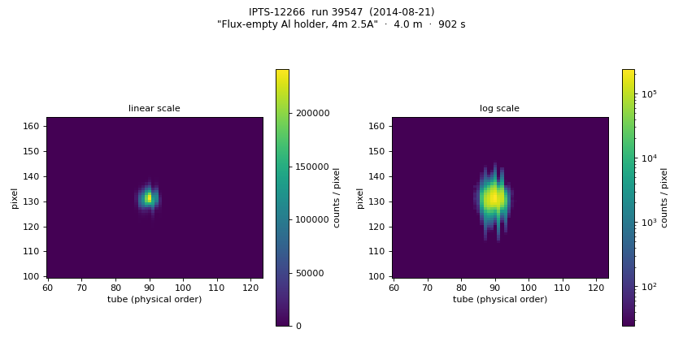

### IPTS-13554

**45214** · 2015-01-22 · 2.5 Å · "Flux-empty Al holder, 4m 2.5A"

**45350** · 2015-01-25 · 2.5 Å · "Flux-empty Al holder, 4m 2.5A"

### IPTS-17292

**68307** · 2016-07-16 · 2.5 Å · "Flux-empty Al holder, 4m 2.5A"

### IPTS-16594

**70203** · 2016-08-29 · 2.5 Å · "T-empty beam 4m 2.5A"

**70225** · 2016-08-29 · 10 Å · "T-empty beam 4m 10A"

**70237** · 2016-08-29 · 2.5 Å · "T-empty beam 4m 2.5A"

**70267** · 2016-08-29 · 10 Å · "T-empty beam 4m 10A"

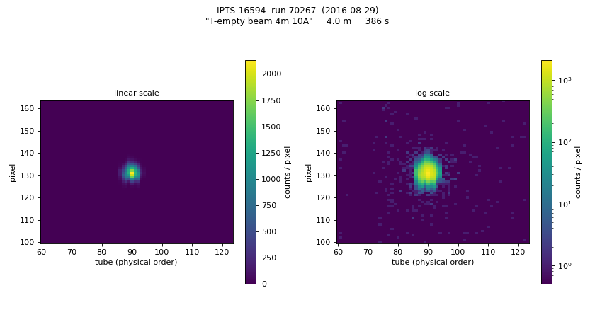

### IPTS-19574

**85326** · 2017-07-22 · 10 Å · "Flux 10a"

**85866** · 2017-07-29 · 10 Å · "Flux 10a"

**86008** · 2017-07-30 · 10 Å · "Flux 10a"

**86245** · 2017-08-03 · 10 Å · "Flux 10a"

### IPTS-19658

**86284** · 2017-08-05 · 10 Å · "Flux 10a"

**87694** · 2017-09-06 · 10 Å · "Flux 10a"

### IPTS-20196

**89165** · 2017-10-31 · 2.5 Å · "T-flux 4m 2.5a"

**89169** · 2017-10-31 · 10 Å · "T-flux 4m 10a"

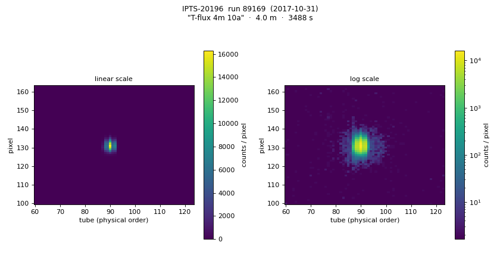

**89270** · 2017-11-02 · 2.5 Å · "T-flux 4m 2.5a"

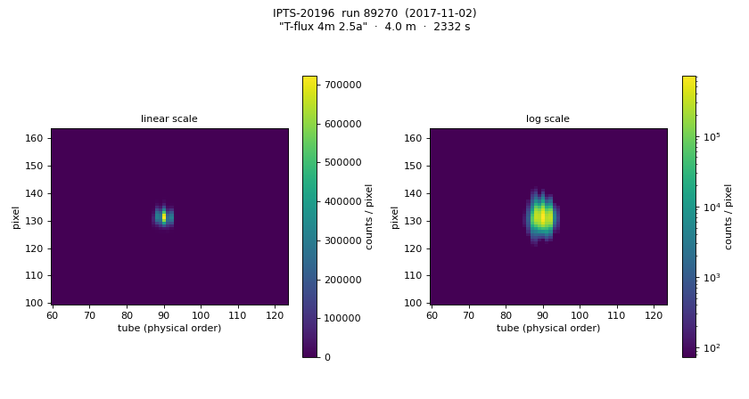

**89274** · 2017-11-02 · 10 Å · "T-flux 4m 10a"

### IPTS-21377

**92459** · 2018-05-23 · 2.5 Å · "T-flux 4m 2.5a"

**92463** · 2018-05-23 · 10 Å · "T-flux 4m 10a"

**92554** · 2018-05-27 · 2.5 Å · "T-flux 4m 2.5a"

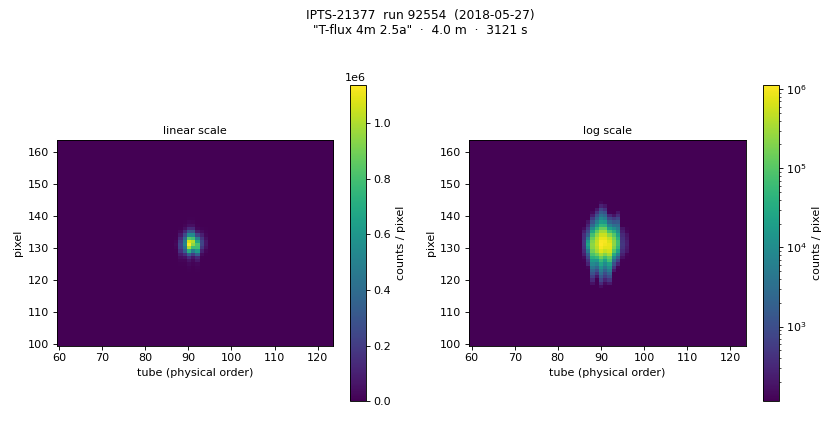

**92558** · 2018-05-28 · 10 Å · "T-flux 4m 10a"

**92850** · 2018-06-02 · 2.5 Å · "T-flux 4m 2.5a"

**92854** · 2018-06-02 · 10 Å · "T-flux 4m 10a"

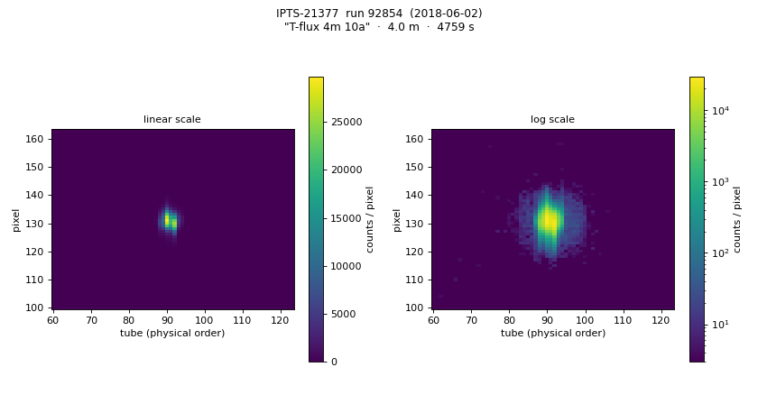

**98755** · 2018-09-26 · 2.5 Å · "T-flux 4m 2.5a"

**98759** · 2018-09-26 · 10 Å · "T-flux 4m 10a"

### IPTS-22747

**102672** · 2019-01-16 · 2.5 Å · "T-flux 4m 2.5a"

**102676** · 2019-01-16 · 10 Å · "T-flux 4m 10a"

**102765** · 2019-01-18 · 2.5 Å · "T-flux 4m 2.5a"

**102769** · 2019-01-18 · 10 Å · "T-flux 4m 10a"

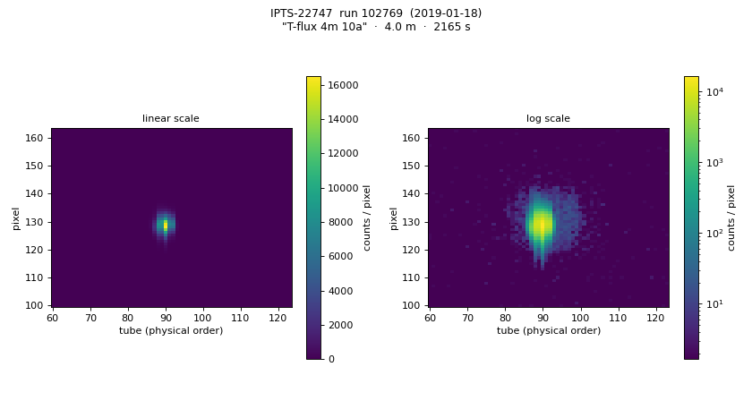

### IPTS-23710

**105769** · 2019-06-27 · 2.5 Å · "T-flux 4m 2.5a"

**105773** · 2019-06-27 · 10 Å · "T-flux 4m 10a"

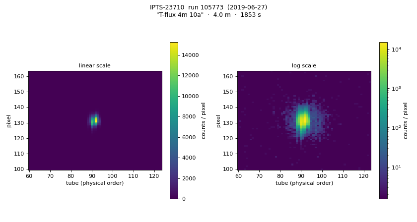

**105866** · 2019-06-29 · 2.5 Å · "T-flux 4m 2.5a"

**105870** · 2019-06-29 · 10 Å · "T-flux 4m 10a"

### IPTS-24648

**108729** · 2019-11-02 · 2.5 Å · "T-empty beam 4m 2.5A" · no direct beam

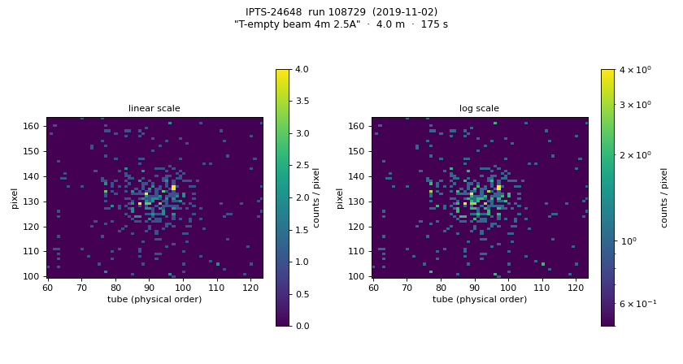

**108735** · 2019-11-02 · 10 Å · "T-empty beam 4m 10a" · no direct beam

**108785** · 2019-11-04 · 2.5 Å · "T-empty beam 4m 2.5A"

**108793** · 2019-11-04 · 10 Å · "T-empty beam 4m 10a"

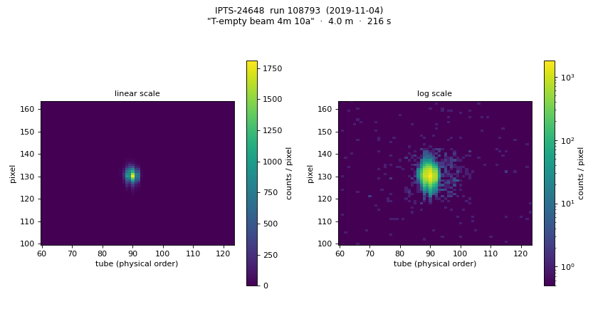

**111228** · 2020-01-06 · 2.5 Å · "T-empty beam 4m 2.5A"

### IPTS-25797

**113490** · 2020-04-06 · 2.5 Å · "T-flux 4m 2.5a"

**113494** · 2020-04-06 · 10 Å · "T-flux 4m 10a"

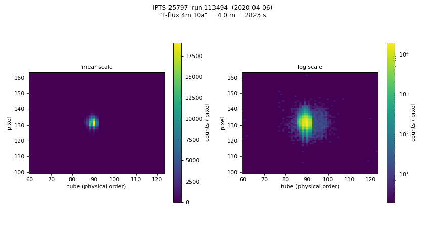

**113558** · 2020-04-08 · 2.5 Å · "T-flux 4m 2.5a"

**113562** · 2020-04-08 · 10 Å · "T-flux 4m 10a"

### IPTS-26015

**115308** · 2020-08-22 · 2.5 Å · "T-empty beam 4m 2.5A"

**115316** · 2020-08-22 · 10 Å · "T-empty beam 4m 10a"

### IPTS-26825

**120664** · 2021-02-13 · 2.5 Å · "T-flux 4m 2.5a" · no direct beam

**120668** · 2021-02-13 · 10 Å · "T-flux 4m 10a" · no direct beam

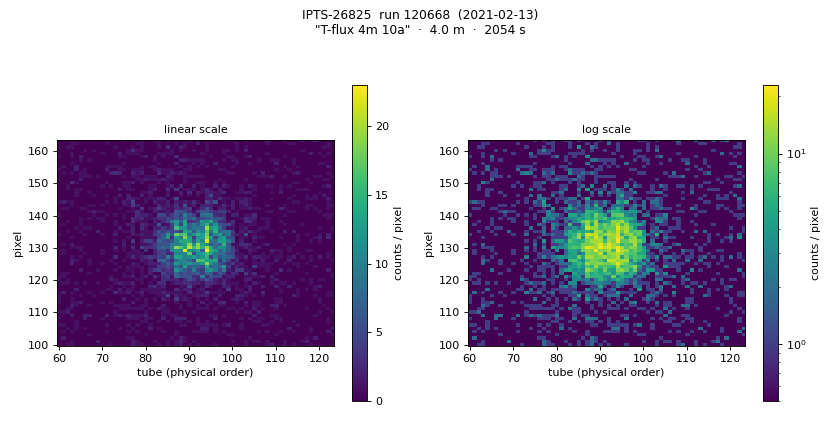

**120756** · 2021-02-16 · 2.5 Å · "T-flux 4m 2.5a" · no direct beam

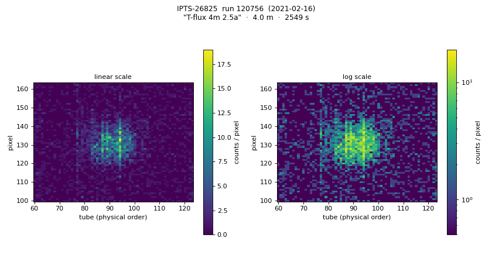

**120760** · 2021-02-16 · 10 Å · "T-flux 4m 10a" · no direct beam

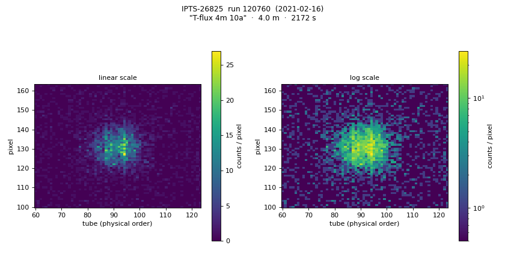

### IPTS-27799

**124754** · 2021-07-14 · 2.5 Å · "T-flux 4m 2.5a"

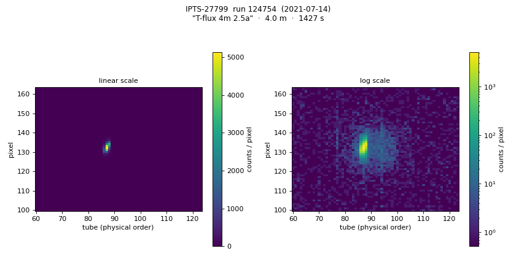

**124760** · 2021-07-14 · 2.5 Å · "T-flux 4m 2.5a"

**124764** · 2021-07-14 · 10 Å · "T-flux 4m 10a"

### IPTS-28942

**129261** · 2022-01-04 · 2.5 Å · "T-flux 4m 2.5a"

**129265** · 2022-01-04 · 10 Å · "T-flux 4m 10a"

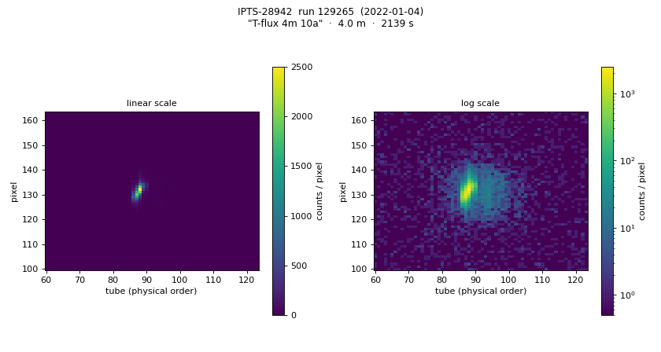

**135061** · 2022-05-23 · 2.5 Å · "T-flux 4m 2.5a" · no direct beam

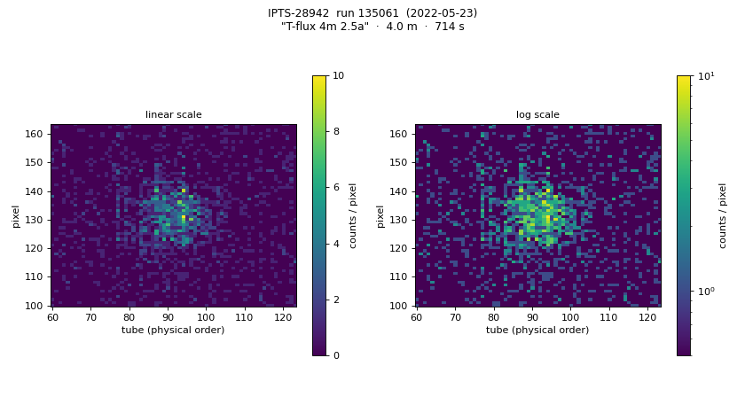

**135065** · 2022-05-23 · 10 Å · "T-flux 4m 10a" · no direct beam

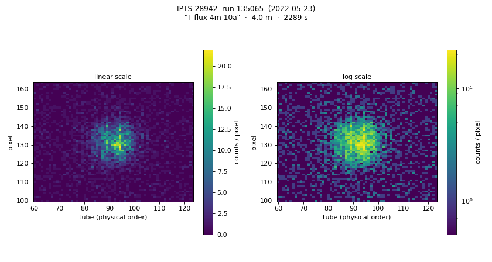

### IPTS-30199

**139944** · 2022-12-21 · 2.5 Å · "T-flux 4m 2.5a"

**139948** · 2022-12-21 · 10 Å · "T-flux 4m 10a"

### IPTS-31849

**144700** · 2023-06-21 · 2.5 Å · "T-flux 4m 2.5a d25_Cd"

**144704** · 2023-06-21 · 10 Å · "T-flux 4m 10a d25_Cd"

### IPTS-33626

**148395** · 2024-07-10 · 2.5 Å · "T-flux 4m 2.5a d25_Cd"

**148399** · 2024-07-10 · 10 Å · "T-flux 4m 10a d25_Cd"

**148461** · 2024-07-12 · 2.5 Å · "T-flux 4m 2.5a d25_Cd"

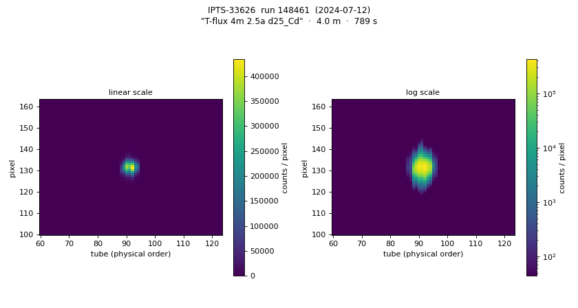

**148465** · 2024-07-12 · 10 Å · "T-flux 4m 10a d25_Cd"

**156241** · 2024-10-20 · 2.5 Å · "T-flux 4m 2.5a d25_Cd"

**156242** · 2024-10-20 · 10 Å · "T-flux 4m 10a d25_Cd"

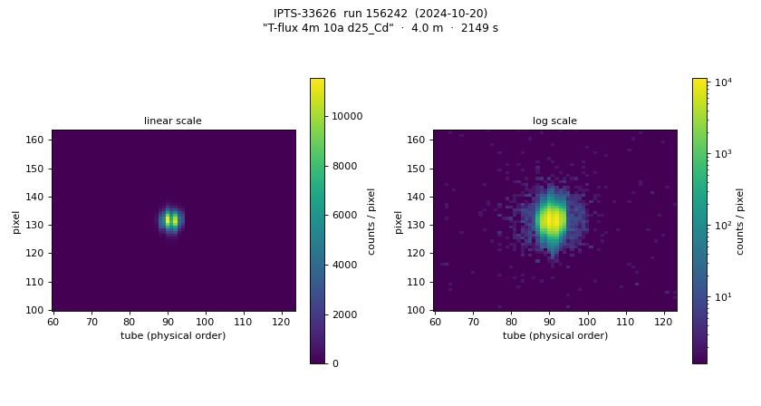

**156244** · 2024-10-20 · 2.5 Å · "T-flux 4m 2.5a d25_Cd"

**156245** · 2024-10-20 · 10 Å · "T-flux 4m 10a d25_Cd"

**156246** · 2024-10-20 · 2.5 Å · "T-flux 4m 2.5a d25_Cd"

**156247** · 2024-10-20 · 10 Å · "T-flux 4m 10a d25_Cd"

**156248** · 2024-10-20 · 2.5 Å · "T-flux 4m 2.5a d25_Cd"

**156249** · 2024-10-20 · 10 Å · "T-flux 4m 10a d25_Cd"

### IPTS-34965

**158588** · 2025-01-28 · 2.5 Å · "T-flux 4m 2.5a d25_Cd"

**158592** · 2025-01-28 · 10 Å · "T-flux 4m 10a d25_Cd"

**158651** · 2025-01-29 · 2.5 Å · "T-flux 1.3m 2.5a d25_Cd"

**158655** · 2025-01-29 · 10 Å · "T-flux 1.3m 10a d25_Cd"

### IPTS-36254

**167525** · 2025-08-12 · 2.5 Å · "T-flux 1.3m 2.5a d25_Cd"

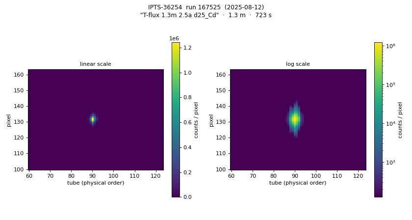

**167529** · 2025-08-12 · 10 Å · "T-flux 1.3m 10a d25_Cd"

**167651** · 2025-08-13 · 2.5 Å · "T-flux 4m 2.5a d25_Cd no window"

**167655** · 2025-08-13 · 10 Å · "T-flux 4m 10a d25_Cd no window"

**175143** · 2025-11-22 · 2.5 Å · "T-flux 4m 2.5a d25_Cd no window"

**175147** · 2025-11-22 · 10 Å · "T-flux 4m 10a d25_Cd no window"

### IPTS-37425

**176582** · 2026-03-12 · 2.5 Å · "T-flux 4m 2.5a d25_Cd no window"

**176591** · 2026-03-13 · 2.5 Å · "T-flux 4m 2.5a d25_Cd no window"

**176595** · 2026-03-14 · 10 Å · "T-flux 4m 10a d25_Cd no window"

### IPTS-37618

**185972** · 2026-08-03 · 2.5 Å · "T-flux 4m 2.5a d25_Cd no window"

**185976** · 2026-08-03 · 10 Å · "T-flux 4m 10a d25_Cd no window"

**186088** · 2026-08-04 · 2.5 Å · "T-flux 4m 2.5a d25_Cd no window"

**186092** · 2026-08-04 · 10 Å · "T-flux 4m 10a d25_Cd no window"

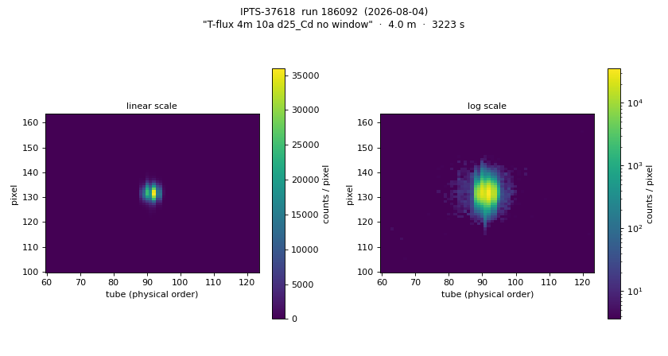
