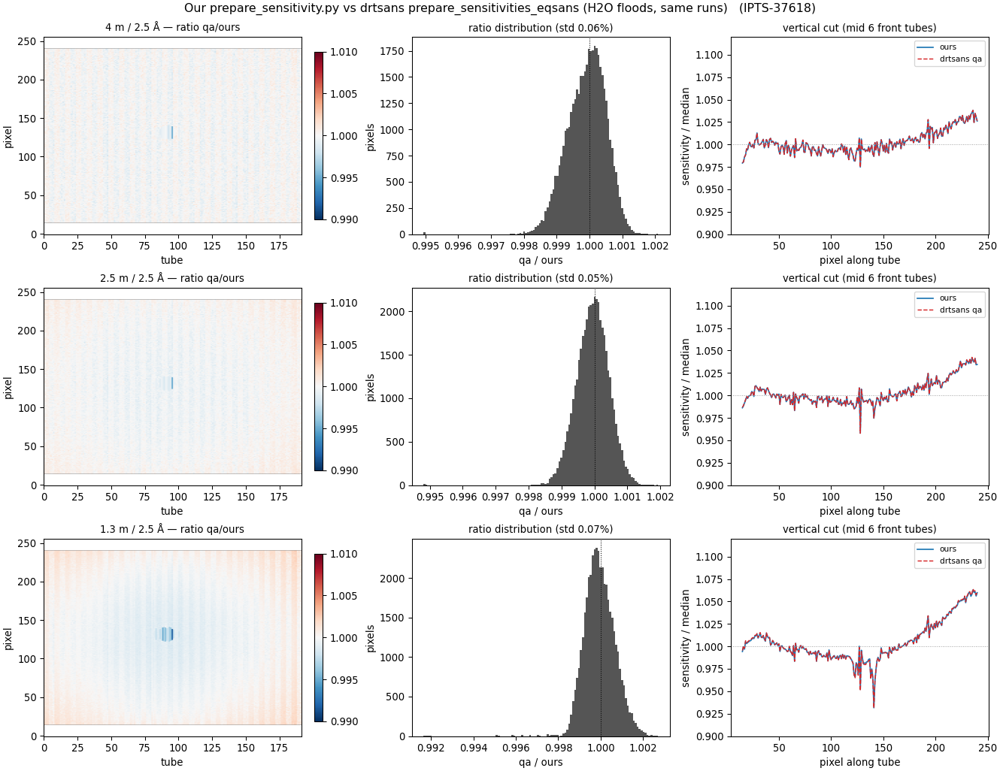

# drtsans sensitivity — the official `prepare_sensitivities_eqsans`, and how it compares

**Date:** 2026-10-26 · **drtsans:** `1.36.0rc2` in the **`sans_qa`** environment (vs our floods built with
stable `1.35.0`) · **data:** IPTS-37618 Oct-2026 H2O batch · **scripts/inputs:**
`2026B_mp/sensitivity_drtsans_qa/*.toml`, `2026B_mp/reduction/floods2026B/compare_qa.py`

The drtsans team has added a first-class EQSANS sensitivity builder that corrects for transmission and
the sample-environment background — the same corrections we had been applying by hand in
`prepare_sensitivity.py`. This page documents how to use it and checks that it agrees with our floods.

## 1. How to build an EQSANS sensitivity with drtsans

Two steps: a TOML configuration file, and one command.

**Run the command** (non-interactive, from any shell):

```bash
pixi run --frozen --manifest-path /usr/local/pixi/sans_qa \
    prepare_sensitivities_eqsans  eqsans_sensitivity.toml  /path/to/output_sensitivity.nxs
```

or interactively, as in the drtsans docs:

```bash
nsd-pixi-shell.sh sans_qa
(sans-qa) prepare_sensitivities_eqsans  eqsans_sensitivity.toml  output_sensitivity.nxs
```

The output path is a command-line argument, not a TOML key. Docs:
<https://drtsans.readthedocs.io/latest/user/sensitivity_eqsans.html>

**The TOML configuration.** Example (our 1.3 m / 2.5 Å H2O flood, IPTS-37618):

```toml
FLOOD_RUNS = [189933]                 # S-H2O-in-banjo (the flood)
DIRECT_BEAM_RUNS = [189924]           # beam-centre run (T-empty NoWindow)
BLOCKED_BEAM_RUNS = 189936            # S-blocked beam, same band (also removes dark)
EMPTY_CELL_RUNS = 189932              # S-empty banjo cell (subtracted)
TRANSMISSION_FLOOD_RUNS = 189926      # T-H2O-in-banjo
TRANSMISSION_EMPTY_CELL_RUNS = 189925 # T-empty banjo
TRANSMISSION_REFERENCE_RUNS = 189924  # T-empty beam (reference)
SAMPLE_OFFSET = 285.0                 # mm   } reduction (AgBe) geometry —
DETECTOR_OFFSET = 66.714              # mm   } same values the reductions use
SCALE_COMPONENTS = { detector1 = [1.004124, 1.057996, 1.0] }
LOW_TOF_CLIP = 1650.0                 # µs, frame-edge cut (fast end)
HIGH_TOF_CLIP = 3150.0                # µs, frame-edge cut (slow end)
MASKED_PIXELS = "1-15,242-256"        # tube ends (15 px each)
MASK_BEAM_CENTER_RADIUS = 40.0        # mm
SOLID_ANGLE_CORRECTION = true
MIN_THRESHOLD = 0.1                   # pixels outside [0.1, 3.0] are masked
MAX_THRESHOLD = 3.0
```

| TOML key | meaning | our value |
|---|---|---|
| `FLOOD_RUNS` | the flood run (H2O in banjo) — **required** | S-H2O |
| `DIRECT_BEAM_RUNS` | beam-centre run — **required** | T-empty NoWindow |
| `BLOCKED_BEAM_RUNS` | blocked beam, same band (also subtracts dark) | S-blocked beam |
| `EMPTY_CELL_RUNS` | empty cell, subtracted (required if transmission set) | S-empty banjo |
| `TRANSMISSION_FLOOD_RUNS` | flood transmission measurement | T-H2O |
| `TRANSMISSION_EMPTY_CELL_RUNS` | empty-cell transmission measurement | T-empty banjo |
| `TRANSMISSION_REFERENCE_RUNS` | empty-beam transmission reference | T-empty NoWindow |
| `SAMPLE_OFFSET`, `DETECTOR_OFFSET`, `SCALE_COMPONENTS` | reduction (AgBe) geometry | from `agbe_calibration/` |
| `LOW_TOF_CLIP`, `HIGH_TOF_CLIP` | frame-edge TOF cuts (µs) | 1650 / 3150 |
| `MASKED_PIXELS` | tube-end mask | `"1-15,242-256"` |
| `MASK_BEAM_CENTER_RADIUS` | beam-centre hole (mm) | 40 |
| `SOLID_ANGLE_CORRECTION` | divide flood by pixel solid angle | true |
| `MIN_THRESHOLD`, `MAX_THRESHOLD` | bad-pixel limits | 0.1 / 3.0 |

**What it does.** It uses the EQSANS detector-patch method (fits the beam-stop hole from the surrounding
tube pixels), divides by the computed solid angle, subtracts the blocked beam and the empty cell, and —
the new part — applies a **wavelength- and θ-dependent transmission correction** T(λ, θ) computed from the
three transmission runs, to the flood and the empty cell, before subtraction. Set all three
`TRANSMISSION_*` keys together or none. The transmission runs must share the band with the flood.

This is the same recipe as our **Sensitivity summary** tab: reduction geometry + solid angle, θ-dependent
self-absorption, empty banjo and blocked beam subtracted, TOF cuts, 15 px tube-end mask.

## 2. Does it agree with our `prepare_sensitivity.py`?

We built the same three H2O floods both ways — our `prepare_sensitivity.py` (stable 1.35.0, a single
flux-weighted transmission value) and `prepare_sensitivities_eqsans` (1.36.0rc2, the measured transmission
runs applied as T(λ, θ) to flood and empty cell) — from the **identical runs and settings**. The only
methodological differences are (a) scalar flux-weighted T vs the measured T(λ, θ) workspace, and (b) the
official method also divides the empty cell by its transmission.



*Left: pixel ratio qa/ours (diverging scale ±1 %). Middle: ratio distribution. Right: the vertical
front-tube section cut from each, overlaid.*

Pixel ratio **qa / ours** over the 43,392 pixels that survive in both (identical masking — 0 pixels differ):

| config | mean | median | std | 1–99 % | max pixel dev | masking diff |
|---|---|---|---|---|---|---|
| 4 m / 2.5 Å | 0.99991 | 1.00000 | 0.058 % | 0.9985 – 1.0011 | 0.51 % | 0 |
| 2.5 m / 2.5 Å | 0.99994 | 1.00000 | 0.049 % | 0.9988 – 1.0010 | 0.52 % | 0 |
| 1.3 m / 2.5 Å | 0.99995 | 0.99991 | 0.072 % | 0.9985 – 1.0017 | 0.83 % | 0 |

**They agree.** The two methods match to **0.05–0.07 % rms**, with the maximum single-pixel deviation
≤ 0.8 % even at 1.3 m, and they mask exactly the same pixels. The vertical section cuts (right column)
overlap to the line width.

The only visible structure is at 1.3 m: a faint **radial** pattern in the ratio map — the official flood a
touch higher at the detector edges and lower near the centre (±0.2–0.3 %). That is exactly the expected
signature of our single flux-weighted scalar T vs the official per-angle **T(λ, θ)** (plus the official
method's transmission correction of the empty cell): the difference is θ-dependent, so it is invisible at
4 m and just appears at 1.3 m's larger angles. It stays well under the flood's own ~2–3 % pixel counting
noise, so for any practical reduction the two floods are interchangeable.

## 3. Which to use going forward

Both methods produce the same flood to within the agreement above, so the **official
`prepare_sensitivities_eqsans` is the method to use going forward** — it is maintained by the drtsans team,
takes a small TOML, and does the transmission correction with the measured T(λ, θ) rather than our scalar
approximation. Our `prepare_sensitivity.py` stays useful for batch builds (18 floods in one loop) and for
the `<flood>.geometry.json` provenance sidecar, and is validated by this comparison. The deployed 2026B
floods (Floods 2026B tab) are unchanged; this is a method cross-check, not a re-deployment.
