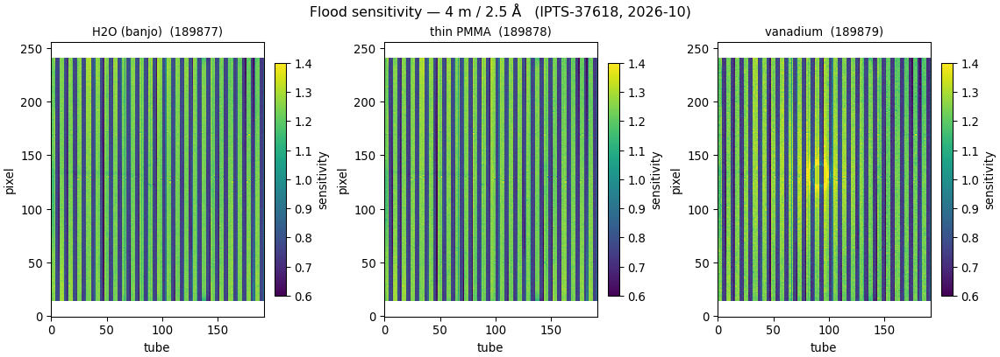
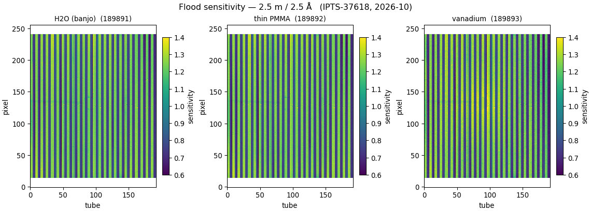
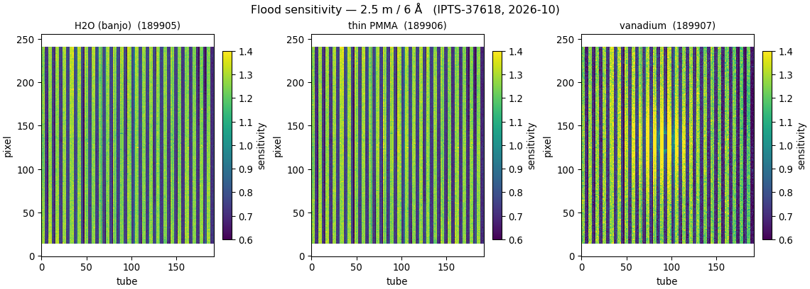
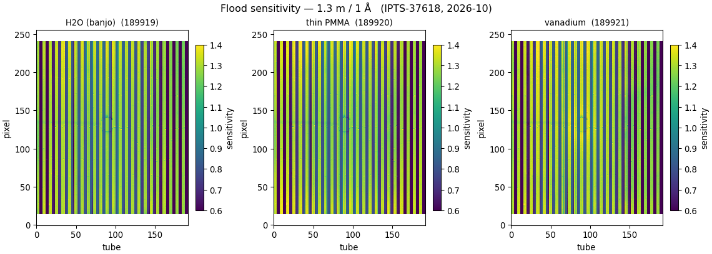
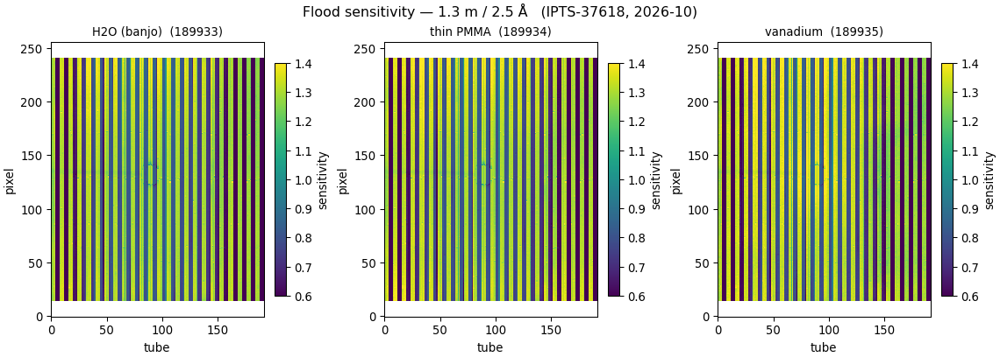
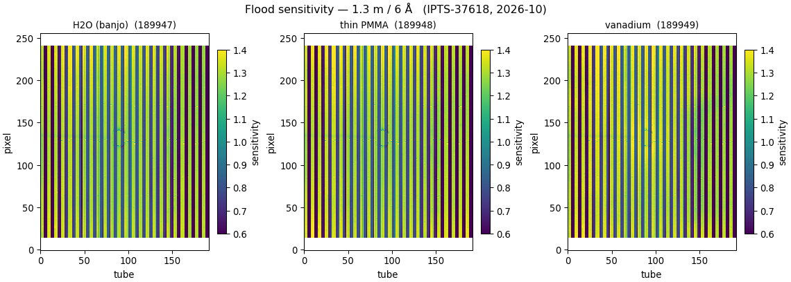
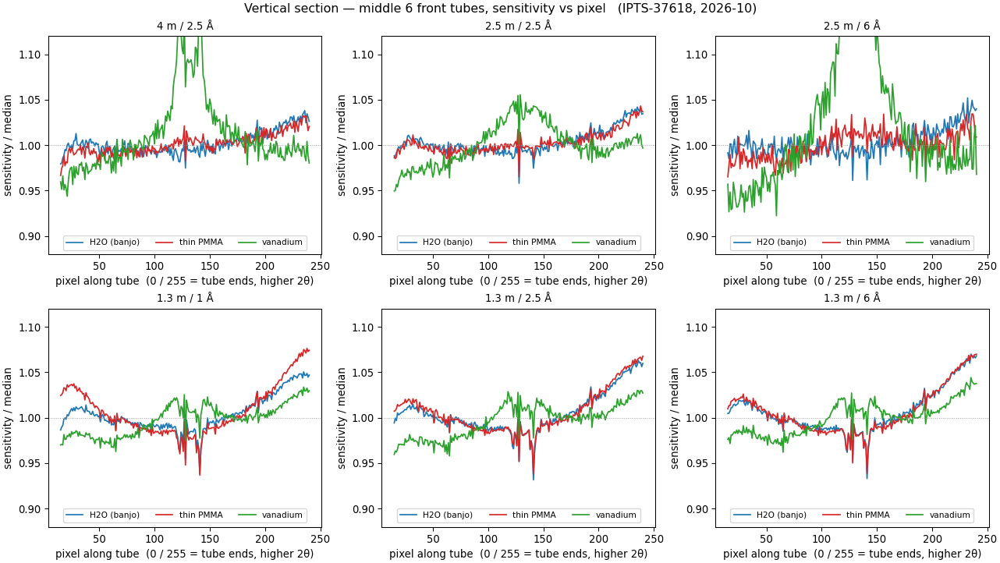
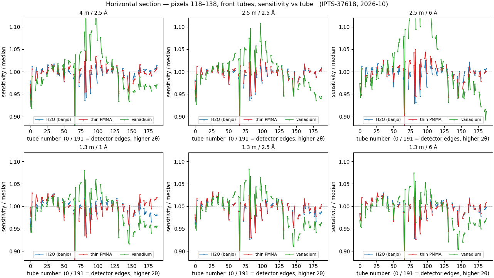

# Floods 2026B — H2O, PMMA and vanadium at every distance and band

**Date:** 2026-10-14 · **drtsans:** stable `1.35.0` · **data:** IPTS-37618, Oct 2026 flood batch
(runs 189867+): a fully-crossed set — every detector distance × wavelength band has **H2O-in-banjo**,
bare **thin PMMA** and bare **vanadium**, each with its own blocked beam, empty-NoWindow and
PeltierWindow, plus all the matching transmission runs · **scripts:**
`2026B_mp/prepare_sensitivity.py` (18 new `CONFIGS` entries), `2026B_mp/reduction/floods2026B/cuts_sens.py`,
`trans_all.py` (flux-weighted transmissions) · **output:** `2026B_mp/sensitivity_2026B/`

This batch lets us build a flood from each candidate material at each configuration and compare them
side by side. Eighteen files were produced — three flood materials × six configurations:

| | 4 m / 2.5 Å | 2.5 m / 2.5 Å | 2.5 m / 6 Å | 1.3 m / 1 Å | 1.3 m / 2.5 Å | 1.3 m / 6 Å |
|---|---|---|---|---|---|---|
| **H2O** (banjo) | 189877 | 189891 | 189905 | 189919 | 189933 | 189947 |
| **thin PMMA** | 189878 | 189892 | 189906 | 189920 | 189934 | 189948 |
| **vanadium** | 189879 | 189893 | 189907 | 189921 | 189935 | 189949 |

File names carry the distance **and** band (`Sensitivity_patched_<sample>_<tag>_<run>.nxs`, tags
`4m2o5a`, `2o5m2o5a`, `2o5m6a`, `1o3m1a`, `1o3m2o5a`, `1o3m6a`), so they coexist with the earlier
distance-only files in `2026B_mp/`.

## How each was built

The same recipe as the deployed H2O floods (see the **Sensitivity summary** tab), applied consistently
to all three materials:

- reduction (AgBe) geometry + computed solid angle;
- θ-dependent self-absorption with the flood's **own** transmission, measured per material and band
  (`trans_all.py`: drtsans `T(λ)` flux-weighted over the 1650/3150 µs band — H2O vs the empty banjo,
  PMMA and vanadium vs the empty beam);
- blocked beam of the **same** configuration subtracted;
- **H2O** additionally has its empty banjo cell subtracted; **PMMA** and **vanadium** are bare, so no
  empty cell is subtracted (blocked beam only);
- TOF cuts 1650/3150 µs, 15 px tube ends masked.

Flux-weighted transmissions used (per material / band):

| | 4 m / 2.5 Å | 2.5 m / 2.5 Å | 2.5 m / 6 Å | 1.3 m / 1 Å | 1.3 m / 2.5 Å | 1.3 m / 6 Å |
|---|---|---|---|---|---|---|
| H2O | 0.587 | 0.589 | 0.495 | 0.631 | 0.584 | 0.488 |
| PMMA | 0.678 | 0.680 | 0.605 | 0.712 | 0.674 | 0.598 |
| vanadium | 0.648 | 0.649 | 0.490 | 0.700 | 0.641 | 0.480 |

Water and vanadium get more absorbing toward long wavelength (0.49 at 6 Å); vanadium's strong long-λ
absorption is the first hint that it is noisier there.

## The maps

Each row is one configuration; columns are H2O / thin PMMA / vanadium, on the same per-panel scale. The
vertical stripes are the real front/back tube alternation (front tubes are less shadowed, so brighter).

H2O and thin PMMA give smooth, low-noise maps. Vanadium is visibly grainier — fewer counts per pixel
(it is a weaker, more absorbing scatterer, especially at 6 Å) — and shows an excess band through the
beam-centre region that H2O and PMMA do not.

## Section cuts — how each material behaves toward the detector ends

To see how the flood shape depends on material *as the angle rises toward the detector edges*, we take
the middle front tubes (front only, so the front/back zig-zag does not swamp the trend) and cut two ways.
Each curve is normalised to its own median, so the comparison is of **shape**, not of the front/back
offset.

**Vertical section** — average of the middle 6 front tubes, sensitivity vs pixel along the tube (pixels
0 / 255 are the tube ends, i.e. the highest 2θ in the vertical direction):

**Horizontal section** — average of a central band of pixels, front tubes only, sensitivity vs tube
number (tubes 0 / 191 are the detector left/right edges, the highest 2θ in the horizontal direction):

What the cuts show:

- **H2O and thin PMMA** are flat to within ±2–3 % across the whole detector, in both directions, at every
  configuration. Their edge behaviour is essentially identical — no material-specific droop or rise.
- **Vanadium** has a pronounced hump of **+5–11 %** through the beam-centre region (vertical cut) and is
  noticeably noisier, worst at 6 Å where its transmission is lowest. That central excess is a real
  feature of the vanadium flood, not shared by H2O or PMMA — it would print a corresponding central
  depression onto every sample reduced with a vanadium flood.

## Which to use

For the 2026B deployment the **H2O-in-banjo** flood stays the choice: flat, low-noise, no structure
near 1 Å⁻¹ (unlike PMMA — see **Water 8**) and no beam-centre hump (unlike vanadium). The new H2O files
are copied into `2026B_mp/` alongside the earlier ones; the 2.5 Å band is the recommended default at each
distance, with the 1 Å (1.3 m) and 6 Å bands as alternatives. The PMMA and vanadium floods are kept here
as candidates for comparison, not for deployment.
